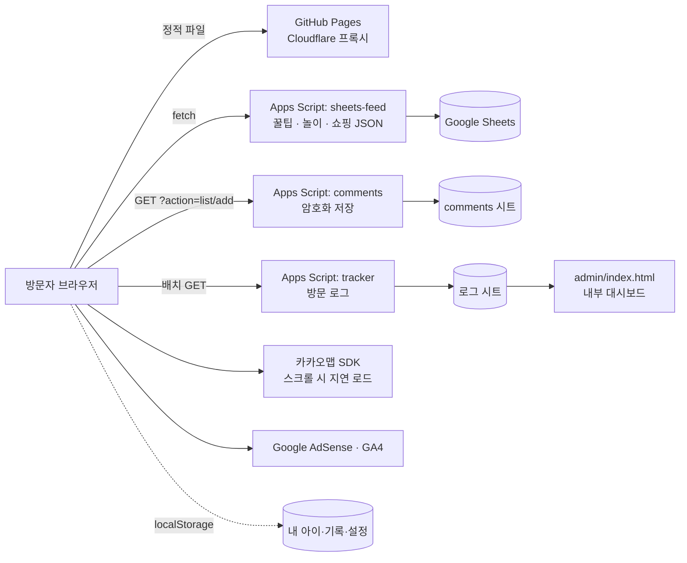

# 아이로그 (noriya.kr)

육아 계산기·체크리스트 **18종** + 놀이 추천 + 육아 꿀팁 + 내 아이 기록을 제공하는 **정적 웹사이트**입니다.
**한국어 · English · 日本語** 3개 언어를 지원하며(국기 버튼으로 전환), 새 언어는 코드 수정 없이 추가할 수 있습니다.

| 항목 | 내용 |
|---|---|
| 형태 | 순수 HTML + CSS + Vanilla JS. **런타임 빌드 없음** (`public/` 폴더가 그대로 배포물) |
| 콘텐츠 CMS | Google Sheets → Apps Script 웹앱(JSON) — 꿀팁 / 놀이 / 쇼핑 |
| 백엔드(서버리스) | Google Apps Script (`apps-script/`) — 익명 댓글(암호화 저장), 방문 로그 수집 |
| 호스팅 | GitHub Pages (GitHub Actions로 배포) + Cloudflare(DNS/CDN), 도메인 `noriya.kr` |
| 개발 도구 | Node.js 18+ (개발 서버 · 정합성 검사 · Playwright E2E). **배포물에는 포함되지 않음** |

---

## 목차

1. [빠른 시작](#1-빠른-시작)
2. [디렉토리 구조](#2-디렉토리-구조)
3. [아키텍처](#3-아키텍처)
4. [다국어(i18n)](#4-다국어i18n)
5. [개발 가이드](#5-개발-가이드)
6. [기능 상세](#6-기능-상세)
7. [외부 서비스 연동 · 설정](#7-외부-서비스-연동--설정)
8. [품질 관리 (검사 · 테스트 · CI)](#8-품질-관리-검사--테스트--ci)
9. [배포 · 운영](#9-배포--운영)
10. [SEO](#10-seo)
11. [보안 · 개인정보](#11-보안--개인정보)
12. [알려진 제약 · 로드맵](#12-알려진-제약--로드맵)
13. [트러블슈팅 FAQ](#13-트러블슈팅-faq)
14. [변경 이력](#14-변경-이력)

---

## 1. 빠른 시작

```bash
# 요구사항: Node.js 18 이상 (.nvmrc 는 20)
npm install                  # 개발 도구 설치 (Playwright). 사이트 자체는 의존성이 없습니다.
npm run dev                  # http://localhost:8000  (PORT=3000 npm run dev 로 포트 변경)
```

- 영어 화면: `http://localhost:8000/?lang=en` · 일본어: `?lang=ja`
- `file://` 로 직접 여는 것은 `fetch()` CORS 때문에 권장하지 않습니다. 반드시 `npm run dev` 를 쓰세요.
- 로컬에서는 방문 로그가 서버로 전송되지 않고 콘솔에만 출력됩니다(`analytics.js`가 localhost를 감지).

### 자주 쓰는 명령

| 명령 | 설명 |
|---|---|
| `npm run dev` | 정적 개발 서버 (`public/` 서빙, 캐시 없음) |
| `npm run check` | **커밋 전 필수.** 문법 · 번역 · 페이지 규약 · 링크를 한 번에 검사 |
| `npm run test:e2e` | 모든 페이지 × 3개 언어를 실제 브라우저로 열어 오류·미번역 검사 (`-- --deep` 로 입력/버튼까지) |
| `npm run new:tool -- <slug> --title "…" --category <c>` | 새 도구 페이지 스캐폴딩 (HTML·CSS·JS·번역·sitemap·카탈로그 자동 생성) |
| `npm run i18n:scaffold -- <lang>` | 새 언어 번역 파일 생성 (원문 주석 포함) |

E2E 를 처음 실행하기 전에는 브라우저를 한 번 설치하세요: `npx playwright install chromium`

---

## 2. 디렉토리 구조

**규칙 한 줄 요약:** 배포되는 것은 `public/` 뿐이고, 그 밖(`apps-script/`, `scripts/`, `tests/`, `templates/`)은 저장소 전용입니다.
페이지 URL(`/index.html`, `/tools/xxx.html` …)은 예전과 **동일**하게 유지되어 SEO·외부 링크에 영향이 없습니다.

```
noriya/
├── README.md                     ← 이 문서 (모든 문서는 여기에)
├── package.json                  npm 스크립트 (dev / check / test:e2e / new:tool / i18n:scaffold)
├── .nvmrc  .editorconfig  .gitignore
│
├── .github/
│   ├── workflows/
│   │   ├── ci.yml                PR·main: 정합성 검사 + E2E
│   │   └── deploy.yml            main → GitHub Pages 배포 (public/ 을 업로드)
│   └── PULL_REQUEST_TEMPLATE.md  PR 체크리스트
│
├── apps-script/                  ← Google Apps Script 서버 코드 (웹에 공개되지 않음. 시트에 붙여 넣어 배포)
│   ├── sheets-feed.gs            시트 → JSON 피드 (꿀팁/놀이/쇼핑 공용)
│   ├── comments.gs               익명 댓글 백엔드 (암호화 저장)
│   ├── tracker.gs                방문 로그 수집 엔드포인트
│   └── ga-proxy.gs               GA4 Data API 프록시 (선택, 현재 미사용)
│
├── scripts/                      ← Node 도구 (의존성 0). 자세한 설명은 8장
│   ├── dev-server.mjs            개발 서버
│   ├── check-syntax.mjs          JS 문법 검사
│   ├── check-i18n.mjs            번역 무결성 검사
│   ├── check-pages.mjs           페이지 규약 검사
│   ├── check-links.mjs           내부 링크 검사
│   ├── new-tool.mjs              새 도구 생성기
│   ├── i18n-scaffold.mjs         새 언어 파일 생성기
│   ├── i18n.config.json          번역 검사 설정 (필수/선택 언어 등)
│   └── lib/                      공용 유틸 (paths, server)
│
├── templates/tool/               ← 새 도구 페이지 템플릿 (tool.html / tool.css / tool.js)
├── tests/e2e/smoke.mjs           ← Playwright E2E 스모크 테스트
│
└── public/                       ← ★ 배포 루트 (GitHub Pages 에 올라가는 전부)
    ├── index.html                홈 — 도구 그리드·검색·내 아이 대시보드
    ├── play.html                 놀이 추천 (목록/상세 SPA, 지도, 댓글)
    ├── tips.html                 육아 꿀팁 (목록/상세 SPA, 댓글)
    ├── shop.html                 육아 쇼핑 & 도서
    ├── growth.html               내 아이 — 프로필·예방접종·성장 기록·뱃지
    ├── tools/                    도구 18종 (아래 표)
    ├── admin/index.html          내부 통계 대시보드 (robots 차단 — 보안 11장 참고)
    ├── CNAME  robots.txt  sitemap.xml  ads.txt
    └── assets/
        ├── css/
        │   ├── style.css         전역 디자인 시스템 (토큰 + 공통 컴포넌트). 상단에 섹션 목차 주석
        │   └── pages/            페이지 전용 스타일 (index.css, play.css, tools/<도구>.css …)
        ├── js/
        │   ├── config.js         런타임 설정 (AdSense·시트 URL·GA·카카오 키 등, 7장)
        │   ├── core/
        │   │   └── analytics.js  방문 로그 수집기 (BTAnalytics)
        │   ├── components/       공통 UI 컴포넌트
        │   │   ├── partials.js   헤더·푸터·하단탭·홈 도구 그리드 생성 (단일 소스)
        │   │   ├── nav.js        메뉴 열기/닫기·검색·현재 페이지 강조·야간모드
        │   │   └── comments.js   익명 댓글 위젯 (play/tips)
        │   ├── features/
        │   │   └── baby.js       "내 아이" 개인화 엔진 (BabyProfile)
        │   ├── data/             ★ 코드가 아닌 "데이터" — 여기만 고치면 되는 것들
        │   │   ├── tool-catalog.js   도구 18종 마스터 목록 (메뉴·홈·검색이 모두 이걸 읽음)
        │   │   └── baby-data.js      예방접종 일정 · 연속 방문 뱃지
        │   └── pages/            페이지 전용 스크립트 (index.js, play.js, tools/<도구>.js …)
        ├── i18n/
        │   ├── i18n.js           다국어 엔진 + 언어 목록 + 국기 SVG
        │   └── locales/{ko,en,ja}/   common.js + <페이지>.js  (번역 사전)
        └── img/og-default.png    SNS 공유 대표 이미지 (1200×630 권장)
```

### 도구 18종 (카탈로그 카테고리 기준)

| 카테고리 (id) | 도구 (`public/tools/…`) |
|---|---|
| 수유·수면 (`수면수유`) | `sleep-calculator` 수면 사이클 계산기 · `feeding-tracker` 수유 간격 타이머 · `colic-checker` 영아산통 체크 |
| 이유식·영양 (`이유식영양`) | `weaning-checker` 재료 월령 체커 · `milk-calculator` 분유·수유량 · `weaning-planner` 이유식 스케줄 |
| 성장·발달 (`성장발달`) | `growth-percentile` 성장 백분위 · `milestone-checker` 발달 마일스톤 · `tooth-checker` 유치 발육 |
| 건강·응급 (`건강응급`) | `fever-medicine` 해열제 용량 · `fever-tracker` 체온 기록·교차 타이머 · `medicine-guide` 약 복용 가이드 |
| 임신·행정 (`임신행정`) | `pregnancy-week` 임신 주수 · `baby-name` 이름 짓기 · `birth-checklist` 출산 준비물 · `school-date` 입소·입학 날짜 · `subsidy-calculator` 지원금 총정리 · `parental-leave` 육아휴직 급여 |

### 어디에 무엇을 넣나 (파일 배치 규칙)

| 만들려는 것 | 위치 |
|---|---|
| 특정 페이지에만 쓰는 스타일 / 스크립트 | `assets/css/pages/…` / `assets/js/pages/…` (HTML 안에 길게 인라인으로 쓰지 않기) |
| 여러 페이지가 공유하는 스타일 | `assets/css/style.css` (기존 토큰·컴포넌트 재사용 먼저) |
| 여러 페이지가 공유하는 UI 로직 | `assets/js/components/` |
| 상태를 가진 기능(프로필 등) | `assets/js/features/` |
| 목록·일정 같은 순수 데이터 | `assets/js/data/` |
| 화면에 보이는 문구 | **항상** `assets/i18n/locales/<언어>/…` (코드/HTML에 직접 쓰지 않기 — 4장) |
| 서버(Apps Script) 코드 | `apps-script/` (절대 `public/` 안에 두지 않기 — 웹에 그대로 노출됨) |
| 개발용 스크립트 / 테스트 | `scripts/` / `tests/` |

### 이전 구조 → 현재 구조

| 이전 | 현재 |
|---|---|
| `index.html` `play.html` `tips.html` `shop.html` `growth.html` `tools/*` | `public/` 아래 동일 경로 |
| `style.css` | `public/assets/css/style.css` |
| 각 HTML 내부 `<style>` / 큰 `<script>` | `assets/css/pages/…` / `assets/js/pages/…` 로 분리 |
| `config.js` | `assets/js/config.js` |
| `analytics.js` | `assets/js/core/analytics.js` |
| `partials.js` · `nav.js` · `comments.js` | `assets/js/components/` |
| `baby.js` | `assets/js/features/baby.js` |
| `partials.js` 안의 `TOOL_CATEGORIES` | `assets/js/data/tool-catalog.js` |
| `baby.js` 안의 `VACCINE_SCHEDULE` · `BADGES` | `assets/js/data/baby-data.js` |
| `i18n/` | `assets/i18n/` |
| `og-default.png` | `assets/img/og-default.png` (`og:image` URL 갱신) |
| `admin/*.gs` | `apps-script/*.gs` (웹 비공개) |
| `admin/GA_SETUP.md` | 이 README 7-7 |
| `og-default_XX.png` | 어디서도 참조되지 않는 파일이라 삭제 |

---

## 3. 아키텍처

### 3-1. 전체 그림



### 3-2. 페이지 해부도 (모든 페이지 공통 규약)

`npm run check:pages` 가 아래 규약을 자동 검사합니다.

```html
<html lang="ko">                                  <!-- 실제 언어는 i18n.js 가 교체 -->
<head>
  <title data-i18n="…">…</title>                  <!-- ko 원문이 기본값, 번역은 data-i18n 으로 -->
  <link rel="canonical" href="https://noriya.kr/…"> + og:url 동일
  <link rel="stylesheet" href="…/assets/css/style.css">
  <!-- ── 스크립트 로드 순서 (중요) ─────────────────────────────── -->
  <script src="…/assets/i18n/i18n.js" data-ns="페이지파일명"></script>   ① 동기. 번역 사전을 먼저 로드
  <script src="…/assets/js/config.js"></script>                          ② CONFIG (AdSense 주입 등)
  <script src="…/assets/js/core/analytics.js"></script>                  ③ 방문 로그
  <script src="…/assets/js/data/tool-catalog.js" defer></script>         ④ 도구 카탈로그 (partials 보다 먼저)
  <script src="…/assets/js/components/partials.js" defer></script>       ⑤ 헤더/푸터 렌더링
  <script src="…/assets/js/components/nav.js" defer></script>            ⑥ 메뉴 동작
  <script src="…/assets/js/data/baby-data.js" defer></script>            ⑦ 예방접종/뱃지 데이터 (baby.js 보다 먼저)
  <script src="…/assets/js/features/baby.js" defer></script>             ⑧ 내 아이 엔진
  <link rel="stylesheet" href="…/assets/css/pages/<페이지>.css">        페이지 전용 스타일
  <script type="application/ld+json">…</script>                          구조화 데이터 (언어에 맞게 자동 번역됨)
</head>
<body data-root-prefix="">                        <!-- 루트 페이지 "", tools/ 페이지 "../" -->
  <div id="siteHeader"></div>                     <!-- partials.js 가 헤더(메가메뉴·모바일메뉴·검색·국기) 삽입 -->
  … 페이지 본문 …
  <div id="siteFooter" data-footer="tool|site"></div>
  <script src="…/assets/js/pages/<페이지>.js"></script>                  <!-- 페이지 메인 스크립트 (문서 끝) -->
</body>
```

- `defer` 스크립트는 문서 순서대로 실행되고 `DOMContentLoaded` 전에 끝납니다. 따라서 `nav.js`·`baby.js` 가 동작할 때는 `partials.js` 가 이미 마크업을 만들어 둔 상태입니다.
- 하단 탭바는 자리표시자 없이 `partials.js` 가 `</body>` 직전에 자동 삽입합니다.
- 홈(`index.html`)에는 추가로 `#catChipsRoot`(카테고리 칩), `#toolHub`(도구 그리드), `#babyDashboard`(내 아이 요약) 자리표시자가 있습니다.
- 광고 슬롯(`<div class="ad-slot ad-top|ad-infeed|ad-result|ad-footer">`)은 페이지 흐름 안에 개별로 둡니다. 슬롯 ID 는 `CONFIG.AD_SLOTS` 에서 주입됩니다.

### 3-3. 전역 객체 (모듈 시스템 없이 협력하는 방식)

| 전역 | 정의 위치 | 역할 |
|---|---|---|
| `I18N` | `assets/i18n/i18n.js` | 언어·번역 함수(`t`, `d`, `field`)·국기 UI |
| `CONFIG` | `assets/js/config.js` | 사이트 설정값 |
| `NORIYA_DATA` | `assets/js/data/*.js` | `toolCategories`, `vaccineSchedule`, `badges` |
| `NORIYA_TOOL_CATEGORIES` | `components/partials.js` | 렌더된 카탈로그(다른 스크립트가 읽기용) |
| `BabyProfile` | `features/baby.js` | 프로필·성장기록·예방접종·스트릭 API |
| `BTAnalytics` | `core/analytics.js` | `trackEvent(name, params)`, `trackContentView(type, id, title)` |
| `NoriyaComments` | `components/comments.js` | `mount(rootId, '접두사-'+id)` |

번들러가 없으므로 **로드 순서가 곧 의존성**입니다. 새 공통 스크립트를 추가할 때는 위 순서(③~⑧)를 지키고, `scripts/check-pages.mjs` 의 `ORDER` 배열에도 등록하세요.

### 3-4. localStorage 키

| 키 | 내용 | 사용처 |
|---|---|---|
| `noriya_lang` | 선택한 언어 코드 | `i18n.js` |
| `babyProfile_v1` | `{ name, birthdate, gender, createdAt }` | `baby.js` |
| `growthRecords_v1` | `[{ id, date, weight, height, note }]` | `baby.js`, `growth` |
| `vaccineDone_v1` | `{ [vaccineKey]: true }` | `baby.js` |
| `visitStreak_v1` | `{ lastVisit, current, longest, totalDays, badges }` | `baby.js` |
| `nightMode_v1` | 야간 모드 | `nav.js` |
| `playDataCache_v1` · `kakaoGeocodeCache_v1` | 놀이 목록 캐시(SWR) · 주소→좌표 캐시(7일) | `play` |
| `feedingLogs` · `tempLogs` · `drugTimes` · `birthChecks` · `playLikes` | 각 도구의 기록 | 해당 도구 |

모두 사용자 브라우저에만 저장되며 서버로 전송되지 않습니다. **스키마를 바꿀 때는 키 접미사(`_v1`→`_v2`)를 올리고 마이그레이션 코드를 넣으세요.**

---

## 4. 다국어(i18n)

### 4-1. 동작 방식

- 지원 언어: 🇰🇷 `ko`(원문) · 🇺🇸 `en` · 🇯🇵 `ja`. 상단 메뉴의 **국기 버튼**(모바일은 슬라이드 메뉴에도 이름 버튼)으로 전환합니다.
- 언어 결정 순서: **`?lang=en`** → 저장된 선택(`localStorage.noriya_lang`) → 기본값 `ko`.
- 전환은 "선택 저장 → 페이지 새로고침" 방식입니다. 계산기처럼 JS로 그려지는 화면이 많아 가장 안정적입니다(입력 중이던 값은 초기화됨).
- **HTML 안의 한국어 원문은 그대로** 두고 `data-i18n` 속성만 붙입니다. JS 가 꺼져 있거나 검색엔진이 볼 때도 한국어가 나옵니다.
- 번역 적용 전 한국어가 번쩍이지 않도록, en/ja 로 열 때는 `html.i18n-pending` 클래스로 잠시 본문을 숨겼다가 적용 후 해제합니다(3초 안전장치).
- `<html lang>`, `og:locale`, `hreflang` 대체 링크, JSON-LD 구조화 데이터의 문자열/`inLanguage` 도 언어에 맞게 자동 변환됩니다.
- **브라우저 언어 자동 감지는 꺼져 있습니다**(`i18n.js` 상단 설정 `autoDetect: false`). 검색엔진 크롤러(영어 헤더)가 한국어 URL을 영어로 색인하는 것을 막기 위함입니다. 첫 방문자는 한국어로 보이고, 외국어 공유 링크는 `…?lang=en` 형태로 사용하세요.

### 4-2. 번역 파일 구조

```
assets/i18n/locales/
├── ko/  common.js  index.js  play.js  tips.js  shop.js  growth.js  sleep-calculator.js  … (페이지당 1개)
├── en/  (ko 와 같은 파일명·같은 키, 값만 영어)
└── ja/
```

- `common.js` : 모든 페이지가 쓰는 문구(메뉴·푸터·도구 이름/설명·예방접종·뱃지·댓글·카테고리명 등)
- `<페이지>.js` : 그 페이지에서만 쓰는 문구. 각 HTML 의 `data-ns="페이지파일명"` 과 이름이 같아야 합니다(`check:pages` 가 검사).
- 각 파일 형식:
  ```js
  I18N.add("en", "sleep-calculator", {
    "sleep-calculator.bedtime": "Bedtime",
    "sleep-calculator.hours_cycles": "{hrs} hours of sleep · {cycles} cycles"
  });
  ```
- **키 이름 규칙**: `<네임스페이스>.<영문 요약 스네이크케이스>` (예: `common.feeding_sleep`). 두 페이지 이상에서 쓰는 문구는 `common.` 으로 올립니다.
- 특수 키: 시트/저장 데이터의 한글 식별자를 화면용으로 바꾸는 `cat.*` · `side.*` · `method.*` · `domain.*`, JSON-LD 용 `ld.*`, 중복 한글 단어 구분용 수동 키(`weaning-planner.weekday_mon`).

### 4-3. 사용법

**HTML**

```html
<h2 data-i18n="sleep-calculator.bedtime">취침 시간</h2>                          <!-- 텍스트 -->
<p  data-i18n-html="sleep-calculator.intro">첫 줄<br>둘째 줄 <b>강조</b></p>      <!-- 태그 포함 -->
<input placeholder="예: 8.5" data-i18n-attr="placeholder:common.example_8_5">      <!-- 속성 (여러 개는 ; 로 구분) -->
<meta name="description" content="…" data-i18n-attr="content:index.meta_description">
```

**JavaScript** (화면에 보이는 문자열을 코드에 직접 쓰지 말고 항상 `I18N.t` 를 통해서)

```js
I18N.t('sleep-calculator.bedtime')                               // 단순 조회
I18N.t('sleep-calculator.hours_cycles', { hrs: 8, cycles: 5 })   // "{hrs}시간 수면 · {cycles}사이클"
I18N.t('common.items', { count: n })                             // 복수형: 사전에 common.items_one / common.items_other
I18N.d('cat', '수면')                                             // 한글 식별자 → 표시용 번역 ("Sleep"), 없으면 원문
I18N.field(record, 'title')                                      // 시트의 title_en / title_ja 우선
I18N.lang   // 'ko' | 'en' | 'ja'      I18N.locale  // 'en-US' 등 → toLocaleString(I18N.locale)
```

### 4-4. 반드시 지킬 규칙

1. **저장/전달되는 값은 번역하지 않습니다.** 예: `localStorage` 에 `'왼쪽'` 으로 저장돼 있거나 시트 `category` 가 `수면` 이면, 값은 그대로 두고 **표시할 때만** `I18N.d('side', v)` / `I18N.d('cat', v)` 를 씁니다(기존 사용자 데이터와 호환).
2. `{placeholder}` 와 `<b>`, `<br>` 같은 태그는 번역문에서도 그대로 유지합니다(`check:i18n` 이 placeholder 불일치를 잡음).
3. 어순이 다른 언어를 위해 문장을 **쪼개서 이어 붙이지 마세요.** `'생후 ' + n + '일'` 대신 `I18N.t('x.days_old', {n})` 로 문장 전체를 한 키로 만듭니다.
4. 같은 한글이 다른 뜻이면 키를 분리합니다(예: 표의 "월"=Month vs 요일 "월"=Mon).
5. 금액은 한국 제도 기준이라 원화(₩/ウォン)를 유지하고 문구만 번역합니다. 날짜·숫자 형식은 `I18N.locale` 로 맞춥니다.
6. 원문(ko)을 고치면 `locales/ko/*.js` 와 HTML 본문 **둘 다** 수정합니다(HTML 본문은 no-JS 대체 표시용).

### 4-5. 새 언어 추가 (예: 독일어)

```bash
npm run i18n:scaffold -- de        # locales/de/*.js 생성 — 키마다 ko/en 원문이 주석으로 붙은 빈 값 파일
```

1. **`assets/i18n/i18n.js`** 상단 `LANGUAGES` 에서 주석 처리된 줄을 풉니다. 국기 SVG(`de`, `fr`, `gb`)는 `FLAGS` 에 이미 있습니다.
   ```js
   { code: 'de', name: 'Deutsch', htmlLang: 'de', locale: 'de-DE', og: 'de_DE', flag: 'de' },
   ```
   다른 나라 국기는 `FLAGS` 에 24×24 SVG 조각만 추가합니다.
2. `locales/de/*.js` 의 빈 값(`""`)을 번역합니다. 아직 비어 있는 키는 **영어 → 한국어 순서로 자동 대체**되므로, 일부만 번역해도 사이트가 깨지지 않습니다. (`common.js` 부터 하면 메뉴가 먼저 번역됩니다)
3. `scripts/i18n.config.json` 의 `optionalLangs` 에 `"de"` 를 추가하고(경고만 표시), 번역이 끝나면 `requiredLangs` 로 옮겨 CI 필수 조건으로 승격합니다.
   ```bash
   npm run check:i18n -- --lang=de    # 누락·미번역 현황
   ```
4. E2E 스모크의 `LANGS`(`tests/e2e/smoke.mjs`)에 `'de'` 를 추가합니다.

언어가 5개 이상이 되면 국기 버튼이 자동으로 **드롭다운**으로 접힙니다(`i18n.js` 상단 설정 `maxInlineFlags`, 기본 4). 독일어처럼 문장이 긴 언어는 버튼/카드 폭이 넘치지 않는지 `?lang=de` 로 모바일 폭(375px)에서 확인하세요.

### 4-6. 구글 시트 콘텐츠 다국어 (꿀팁·놀이·쇼핑)

시트 데이터는 코드로 번역되지 않으므로 **텍스트 열에 `_언어코드` 접미사 열을 추가**합니다. 값이 채워져 있으면 그 언어 화면에서 자동으로 우선 사용되고, 비어 있으면 한국어 원문이 나옵니다(행 단위로 점진 번역 가능).

- 번역 열을 만들 수 있는 열: `title`, `summary`, `content`, `name`, `location`, `tags`, `desc`, `description`
  - 꿀팁: `title`, `summary`, `content`, `tags` · 놀이: `title`(또는 `name`), `summary`, `content`, `location`, `tags` · 쇼핑: `name`, `summary`
- 번역 열이 필요 없는 열: `id`, `emoji`, `date`, `price`, `discount`, `age`, `link`, `views` 등
- 예: `id | category | emoji | title | title_en | title_ja | summary | summary_en | summary_ja | content | content_en | …`
- `category` 는 필터용 식별자라 `category_en` 이 적용되지 않습니다. 화면 이름은 사전의 `cat.<한글카테고리>` 로 번역하며, **새 카테고리를 만들면 `common.js`(ko/en/ja)에 `"cat.새카테고리": "번역"` 을 추가**하세요. 없으면 한국어로 표시됩니다.
- `apps-script/sheets-feed.gs` 는 시트 헤더를 그대로 JSON 키로 내보내므로 코드 수정이 필요 없습니다. 열을 추가한 뒤에는 웹앱을 **새 버전으로 재배포**해야 반영됩니다.
- `tags` 는 쉼표 구분 텍스트이므로 `tags_en` 도 같은 형식으로, `content_en` 도 한국어 `content` 와 같은 서식(줄바꿈/HTML)을 유지하세요.

### 4-7. 번역 품질 검사

`npm run check:i18n` 이 확인하는 것: 언어별 **키 누락** · **{placeholder} 불일치** · 번역문에 **한글 잔존(미번역)** · 코드에서 쓰는 키가 실제 사전에 **존재하는지**(그 페이지에서 로드되는 네임스페이스 기준) · 쓰이지 않는 키(경고). E2E 는 en/ja 화면(계산 결과 화면까지)에 한글이 남는지 브라우저에서 다시 확인합니다.

> 의학·제도 용어는 원어민 검수를 한 번 받는 것을 권장합니다.

---

## 5. 개발 가이드

### 5-1. 코딩 컨벤션

- **들여쓰기 2칸, UTF-8, LF** (`.editorconfig`). 파일 끝 개행.
- **HTML**: 시맨틱 태그 사용, 화면 문구는 `data-i18n*`, 이벤트는 기존 패턴(`onclick`) 유지 가능하나 새 코드는 `addEventListener` 권장.
- **CSS**: 색상·라운딩·그림자는 **하드코딩하지 말고 `:root` 토큰**(`--primary`, `--radius` …)을 씁니다. 페이지 전용 규칙만 `pages/*.css` 에.
- **JS**: 전역 오염을 피하기 위해 새 모듈은 IIFE + `'use strict'`. 화면 문자열은 `I18N.t`. 사용자 입력·시트 값을 `innerHTML` 에 넣을 땐 이스케이프하거나 `textContent` 를 쓰세요(댓글은 항상 `textContent`).
- **파일명**: 도구/페이지는 `kebab-case.html`, 페이지 스크립트·스타일·번역 파일명은 HTML 파일명과 동일.
- **커밋/브랜치**: `main` 은 항상 배포 가능 상태. 기능 브랜치 → PR → CI 통과 → 머지. 커밋 메시지는 `feat: …`, `fix: …`, `i18n: …`, `docs: …` 형식을 권장합니다.
- 화면에 보이는 새 문구를 추가하면 **ko·en·ja 3개 언어를 함께** 넣습니다(PR 체크리스트 항목).

### 5-2. 새 도구 추가

**자동 (권장)**

```bash
npm run new:tool -- twin-growth --title "쌍둥이 성장 비교" --category growth \
    --desc "쌍둥이의 키와 몸무게를 나란히 비교해 보세요." --emoji 👯 --badge new
```

카테고리 별칭: `sleep` · `weaning` · `growth` · `health` · `pregnancy` (또는 카탈로그 id 그대로). `--badge` 는 `hot|new|popular`(생략 가능).

만들어지는 것: `public/tools/<slug>.html` · `assets/css/pages/tools/<slug>.css` · `assets/js/pages/tools/<slug>.js` · `locales/{ko,en,ja}/<slug>.js` · `common.js` 에 이름/설명/검색어 키 · `tool-catalog.js` 항목(→ **메뉴·홈 카드·검색에 자동 노출**) · `sitemap.xml` 항목.

이후 할 일:
1. `<slug>.js` 의 `calculate()` 와 HTML 입력 카드를 실제 도구에 맞게 작성
2. en/ja 번역의 `TODO: ` 접두어를 실제 번역으로 교체 (남아 있으면 `check:i18n` 이 **실패**하도록 일부러 만들었습니다)
3. 홈/메뉴의 "도구 18개" 같은 숫자 문구가 있으면 갱신(`locales/*/common.js`, `index.js` 에서 검색)
4. `npm run check && npm run dev` 로 확인

**아이 정보 자동 입력을 지원하려면** 입력 요소 id 를 규칙대로 지으세요(그러면 `baby.js` 수정 없이 동작).
`birthDate`(date) · `ageMonth`(number) · `monthSel`(select) · `monthBtns`(버튼 그룹) · `genderSel`. 다른 패턴은 `baby.js` 의 `autofillAgeInputs()` 에 분기를 추가합니다.

**수동으로 만들 때의 체크리스트**: 템플릿(`templates/tool/`) 복사 → canonical/og:url/JSON-LD URL → `data-ns` = 파일명 → `body data-root-prefix="../"` → 카탈로그 항목 → 번역 3개 언어 → `sitemap.xml` → `npm run check`.

### 5-3. 도구 수정·삭제·정렬

- **이름·설명·이모지·배지·카테고리 이동·순서**: `assets/js/data/tool-catalog.js` 한 파일만 수정 → 메가메뉴, 모바일 메뉴, 홈 카테고리 칩, 홈 도구 그리드, 검색 키워드가 모두 동기화됩니다.
  ```js
  { href: 'tools/new-tool.html', emoji: '🧷', name: I18N.t('common.…'), desc: I18N.t('common.…'),
    badge: 'new', kwKo: '한국어 검색어 나열', keywords: I18N.t('common.…') }
  ```
  `badge`: `'hot'`(인기) · `'new'` · `'popular'`(추천) · 생략. `kwKo` 는 언어와 무관하게 한국어로도 검색되게 하는 값입니다.
- 카테고리 사이 인피드 광고 위치: 카테고리 객체의 `adSlotAfter: 'INFEED_1'` 값을 옮깁니다.
- **삭제**: 카탈로그 항목 삭제 + HTML/CSS/JS/번역 파일 삭제 + `sitemap.xml` 항목 삭제 → `npm run check`(링크/사전 오류로 누락 확인).

### 5-4. 디자인 시스템

`assets/css/style.css` 의 `:root` 토큰을 바꾸면 전체 사이트 톤이 함께 바뀝니다. (파일 상단에 섹션 목차 주석이 있습니다.)

| 토큰 | 값 | 의미 |
|---|---|---|
| `--primary` / `--primary-dark` / `--primary-mid` / `--primary-light` | `#4A7C59` / `#33573F` / `#CFE6D9` / `#EEF5F0` | 포근한 세이지 그린 (브랜드) |
| `--amber` / `--amber-light` / `--amber-mid` | `#E9A825` / `#FBF4E4` / `#F4E8C1` | 샌드 옐로우 (D-day·추천 강조) |
| `--page-bg` / `--surface` | `#F9F9F6` / `#F0F0EA` | 오프 화이트 배경 / 카드 내부 보조 |
| `--radius` / `--radius-sm` / `--radius-lg` | `20px` / `14px` / `24px` | 둥근 카드 |
| 폰트 | Pretendard(CDN) → Noto Sans KR 폴백 (ja 는 Noto Sans JP/Hiragino 우선) | |

결과 카드 상태 색: 세이지=안전, 샌드=주의, 레드=경고.

주요 공통 컴포넌트: `.bottom-nav`(모바일 하단 4탭) · `.pill-btn` / `.calc-btn`(큰 버튼, 한 손 조작) · `.result-box` · `.info-box` / `.warn-box` / `.disclaimer` · `.cat-chip-scroll` · `.cat-filter`(sticky 필터) · `.skeleton`(로딩) · `.radial-timer`(원형 타이머, `fever-medicine` 참고) · `.quick-chip` / `.stepper-btn` · `.comments-section` · `.lang-switch`(국기). 카드·버튼은 탭 시 `scale(.97)` 로 눌리는 마이크로 인터랙션을 공통 적용합니다.

---

## 6. 기능 상세

### 6-1. 전역 내비게이션 · 공통 컴포넌트 (`components/partials.js`)

예전에는 헤더·메가메뉴·모바일 메뉴·검색 오버레이·하단 탭바·푸터·홈 도구 카드가 22개 HTML 에 복사돼 있어 도구 하나를 바꾸려면 파일 22개를 고쳐야 했습니다(푸터 연도가 `© 2024`/`© 2026` 으로 제각각이던 것이 그 사례). 지금은 `partials.js` 가 `tool-catalog.js` 를 읽어 다음을 모두 생성합니다.

- 상단 메가메뉴(데스크톱: 카테고리 드롭다운 · 모바일: 햄버거 + 아코디언), 검색 오버레이(제출 시 `index.html?q=검색어` → 홈에서 자동 필터), 하단 탭바(홈/놀이/꿀팁/내 아이), 푸터, 홈 카테고리 칩과 18개 도구 그리드, 국기 버튼 슬롯(`[data-lang-switch]`), 아이 배지 슬롯(`[data-baby-badge]`)
- 페이지는 자리표시자만 둡니다: `#siteHeader`, `#siteFooter[data-footer="tool|site"][data-home-label]`, (홈) `#catChipsRoot` · `#toolHub`
- 각 페이지의 `body[data-root-prefix]`(`""`/`"../"`)를 읽어 상대경로를 자동으로 맞춥니다.
- `nav.js` 는 현재 페이지 강조·메뉴/검색 토글·야간 모드를 담당합니다.

### 6-2. 내 아이 시스템 (`features/baby.js` + `growth.html`)

서버 없이 `localStorage` 만으로 동작하며 재방문을 늘리기 위한 기능입니다(① 매번 생년월일 입력하는 마찰 제거 ② 시간이 지나면 값이 바뀌는 "돌아올 이유" ③ 습관 시각화).

- `BabyProfile`: 프로필 CRUD, 나이 계산, 성장 기록 CRUD, 예방접종 D-day, 연속 방문 스트릭·뱃지(3/7/14/30/100/365일)
- 상단 배지: 프로필 있으면 "이름 · 나이(+스트릭)", 없으면 "내 아이 등록" CTA → `growth.html`
- 홈 `#babyDashboard`: 오늘 요약 카드 + 월령 기반 "오늘의 추천" 배너(`renderHomeDashboard()`)
- 자동 입력이 적용된 도구: `birthDate` → `school-date`, `subsidy-calculator` · `ageMonth` → `fever-medicine`, `growth-percentile` · `monthSel` → `milk-calculator` · `monthBtns`+`genderSel` → `tooth-checker`, `milestone-checker`, `weaning-checker`, `weaning-planner`, `growth-percentile`. 자동 입력 시 토스트("○○의 정보로 자동 입력했어요")를 띄웁니다.
- 예방접종 일정(`data/baby-data.js`)은 질병관리청 국가필수예방접종 표준 일정을 **간소화한 참고용**입니다. 수정할 땐 `growth.html` 안내 문구도 함께 검토하세요.
- 테스트: 프로필 저장 → 요약/접종/뱃지 갱신 · 도구 페이지 자동 입력 토스트 · 모든 페이지 배지 일관성 · 하루 이상 뒤 재방문 시 스트릭 유지 · 기록 2건 이상 → Chart.js 그래프 · "정보 삭제" 시 전체 초기화.

### 6-3. 익명 댓글 (`components/comments.js` + `apps-script/comments.gs`)

`play.html` 액티비티 상세("비슷한 액티비티" 위)와 `tips.html` 꿀팁 상세("관련 꿀팁" 위)에 붙는 위젯입니다.

- **완전 익명**(로그인·닉네임·기기 식별 없음), 최대 **200자**(이모지 포함 코드포인트 기준, 클라이언트 실시간 카운터 + 서버 재검증)
- **암호화 저장**: 브라우저가 보낸 평문을 Apps Script 서버 안에서만 아는 키로 암호화해 시트에 저장하고, 조회할 때만 복호화합니다. 키는 브라우저·저장소·시트 어디에도 없습니다(Script Properties 에만 저장).
  - 방식: 댓글마다 무작위 IV → `키스트림 = HMAC-SHA256(키, IV‖0) ‖ HMAC-SHA256(키, IV‖1) ‖ …` → `암호문 = 평문 XOR 키스트림` → `MAC = HMAC-SHA256(키, IV‖암호문)`(Encrypt-then-MAC). Apps Script 에 AES 가 없어 내장 HMAC 만으로 구성했습니다.
  - **위변조 감지**: 조회 시 MAC 을 재계산해 불일치(시트를 손으로 고친 경우)하면 그 댓글만 조용히 건너뜁니다.
  - 시트 열: `id · activity_id · iv · ct(암호문) · mac · 시각`
- **네임스페이스**: play 와 tips 의 `id` 는 서로 다른 시트에서 독립적으로 매겨져 겹칠 수 있으므로 `mount('commentsRoot', 'play-'+item.id)` / `'tip-'+tip.id` 처럼 **콘텐츠별 접두사**를 붙입니다. 새 콘텐츠에 붙일 땐 반드시 새 접두사를 쓰세요.
- 표시용 동물 이모지·"익명의 OO" 닉네임은 댓글 id 로 브라우저가 그 자리에서 계산하는 장식일 뿐 작성자 추적 정보가 아닙니다. 사용자 입력은 항상 `textContent` 로만 렌더링합니다(저장형 XSS 차단).
- 요청은 `POST` 가 아니라 **`GET` + 쿼리**(`?action=list|add`)입니다. Apps Script 웹앱이 302 리다이렉트하면서 브라우저 `fetch` 가 POST 본문을 잃는 표준 동작 때문입니다(200자 ≈ URL 인코딩 후 1,800자로 제한 안에 들어감).
- `CONFIG.COMMENTS_URL` 이 비어 있으면 "댓글 기능이 곧 열릴 예정이에요" 안내만 나오고 나머지는 정상 동작합니다.
- **배포**: [script.google.com](https://script.google.com) 새 프로젝트(또는 댓글 저장용 시트의 Apps Script) → `apps-script/comments.gs` 전체 붙여넣기 → 배포 → 웹 앱(실행: 나 / 액세스: 모든 사용자) → URL 을 `config.js` 의 `COMMENTS_URL` 에 입력 → (선택) 편집기에서 `selfTest` 실행. 첫 댓글 등록 시 무작위 키가 자동 생성됩니다(`initSecretKey()` 로 미리 만들 수도 있음).
- 미구현(필요 시 확장): 신고/삭제/모더레이션 UI(`action=delete` + 관리자 확인), 비속어 필터·도배 방지(익명성과 상충하는 IP/기기 제한은 일부러 제외).

### 6-4. `play.html` 성능 설계

- **Apps Script 콜드 스타트** 대응: 응답을 `localStorage(playDataCache_v1)` 에 캐시하고 **stale-while-revalidate** — 캐시가 있으면 즉시 렌더, 5분 지나면 백그라운드 갱신, 24시간 지나면 폐기.
- **지오코딩 캐시**: 주소→좌표를 `kakaoGeocodeCache_v1` 에 7일 캐시, 대상은 상위 24개로 제한("가까운 5곳"만 보여주므로).
- **지도 지연 로딩**: `IntersectionObserver` 로 지도 섹션 400px 앞에서 도달했을 때만 카카오 SDK 로드 + 지오코딩 시작. 랭킹/연령별/실시간/최저가 섹션은 지도와 무관하게 즉시 렌더.
- `dapi.kakao.com` · `script.google.com` · `pagead2.googlesyndication.com` 에 `preconnect`.
- 검증: 개발자 도구 Network 에서 지도 스크롤 전에 `dapi.kakao.com` 요청이 없는지, 재방문 시 목록이 즉시 뜨는지, Lighthouse LCP.

### 6-5. 방문 분석 (`core/analytics.js`)

자체 수집기(5초 배치, 최대 20건, GET 전송)로 유입경로·기기/브라우저/국가·이동 경로·체류시간·이탈·광고/제휴 이벤트를 `apps-script/tracker.gs` 에 보내고, 선택적으로 GA4(`CONFIG.GA_ID`)도 주입합니다. localhost 에서는 전송하지 않고 콘솔에만 출력합니다. 페이지 이름은 `PAGE_MAP` 에 없으면 파일명을 씁니다(새 도구는 등록하지 않아도 됨).

| 이벤트 | 설명 | 주요 파라미터 |
|---|---|---|
| `page_view_custom` | 페이지 진입 | `page_name`, `referrer` |
| `scroll_depth` | 스크롤 깊이 | `depth_percent` (25/50/75/100) |
| `tool_calculate` | 계산 버튼 클릭 | `page_name`, `button_text` |
| `tool_filter` | 필터 버튼 클릭 | `filter_value` |
| `card_click` | 카드 클릭 | `card_name` |
| `outbound_click` | 외부 링크 클릭 | `link_domain`, `is_affiliate` |
| `ad_impression` | 광고 슬롯 노출 | `ad_slot` |
| `time_on_page` | 체류 시간 | `seconds`, `max_scroll` |
| `site_search` | 내부 검색 | `search_term` |
| `js_error` | JS 오류 | `message` |

상세 화면(SPA)에서는 `BTAnalytics.trackContentView(type, id, title)` / `trackEvent(name, params)` 를 호출합니다.

### 6-6. Admin 대시보드 (`public/admin/index.html`)

방문 통계/이벤트 대시보드(Chart.js). `robots.txt` 차단 + `noindex, nofollow`, `CONFIG.ADMIN_PASSWORD` 로 잠금. **비밀번호 방식의 한계는 11장을 반드시 읽으세요.**

---

## 7. 외부 서비스 연동 · 설정

### 7-1. `assets/js/config.js` 설정 키

> ⚠ 이 파일은 브라우저에 그대로 공개됩니다. **진짜 비밀(서비스 계정 키·실제 관리자 비밀번호)은 넣지 마세요.**

| 키 | 용도 | 비고 |
|---|---|---|
| `ADSENSE_CLIENT` | AdSense 퍼블리셔 ID | 비우거나 `ca-pub-XXXX…` 면 광고 스크립트 미주입 |
| `AD_SLOTS` | `TOP_BANNER` `INFEED_1` `INFEED_2` `IN_RESULT` `FOOTER` 슬롯 ID | AdSense 콘솔 → 광고 단위 |
| `SHEET_JSON_URL` | 꿀팁 시트 웹앱 URL | 비면 `tips.html` 이 내장 샘플 데이터로 표시 |
| `PLAY_SHEET_URL` | 놀이 시트 웹앱 URL | |
| `SHOP_SHEET_URL` | 쇼핑 시트 웹앱 URL | 비면 `shop.html` 내장 샘플 |
| `COMMENTS_URL` | 댓글 웹앱 URL | 비면 "곧 열릴 예정" 안내 |
| `TRACKER_URL` | 방문 로그 웹앱 URL | 비면 수집 안 함 |
| `GA_ID` | GA4 측정 ID(`G-…`) | 선택 |
| `GA_PROPERTY_ID` · `GA_PRIVATE_KEY` · `ADMIN_PASSWORD` | admin 관련 | **공개 노출됨 — 11장** |
| `KAKAO_MAP_KEY` | 카카오맵 JS 키 | 카카오 개발자 콘솔에서 **도메인 등록 필수**(미등록 시 "카카오 도메인 미등록" 오류) |
| `SITE_NAME` · `SITE_URL` · `CONTACT_EMAIL` | 사이트 기본 정보 | |

### 7-2. Google Sheets → 콘텐츠 (`apps-script/sheets-feed.gs`)

| 페이지 | 설정 키 | 시트 | JSON 형태 |
|---|---|---|---|
| `tips.html` (+ 홈 미리보기) | `SHEET_JSON_URL` | Sheet1 꿀팁 | `{ "tips": [...] }` 또는 배열 |
| `play.html` (+ 홈 미리보기) | `PLAY_SHEET_URL` | Sheet2 놀이 | `{ "activities": [...] }` (`tips` 도 허용) 또는 배열 |
| `shop.html` | `SHOP_SHEET_URL` | Sheet3 쇼핑 | `{ "items": [...] }` 또는 배열 |

**시트 열(첫 행이 헤더)**: 꿀팁 `id, category, emoji, title, summary, content, tags, date` · 쇼핑 `id, section(essentials|ebook), category, emoji, name, summary, price, discount, link, ageMonth` · 놀이는 `id, category, emoji, title|name, age, price, discount, location(주소), link, tags, summary, content` 등을 읽습니다. 다국어 열은 4-6 참고.

**배포 절차**: 스프레드시트 → 확장 프로그램 → Apps Script → `sheets-feed.gs` 붙여넣기 → 상단 `SHEET_INDEX`(0/1/2)·`RESPONSE_KEY` 수정 → 배포 → 새 배포 → 웹 앱(실행: 나 / 액세스: 모든 사용자) → URL 을 `config.js` 의 해당 키에 입력. **열을 추가/수정한 뒤에는 "새 버전"으로 재배포**해야 합니다. 시트를 고쳐도 `play` 는 캐시(SWR) 때문에 최대 5분 정도 이전 데이터가 보일 수 있습니다.

### 7-3. 방문 로그 (`apps-script/tracker.gs`)

로그 저장용 스프레드시트에 붙여 넣고 웹 앱으로 배포 → URL 을 `TRACKER_URL` 에 입력(스크립트 상단 주석의 단계 참고). `admin/index.html` 이 같은 URL 을 읽어 시각화합니다(대시보드의 URL 입력칸 값도 `TRACKER_URL` 과 같아야 함).

### 7-4. 카카오맵 · AdSense

- 카카오맵: `KAKAO_MAP_KEY` 로 `ensureKakaoSDK()` 가 **필요할 때만 동적 로드**합니다(하드코딩된 다른 키로 중복 로드하지 않음). 배포 도메인(`https://noriya.kr`)과 로컬(`http://localhost:8000`)을 카카오 개발자 콘솔 플랫폼에 등록하세요.
- AdSense: `config.js` 가 스크립트를 head 에 주입하고, 각 `.ad-slot` 안의 작은 스크립트가 `data-ad-client`/`data-ad-slot` 을 `CONFIG` 값으로 채웁니다. `public/ads.txt` 에 퍼블리셔 인증 줄이 있어야 합니다.

### 7-5. 그 밖의 설정 파일

댓글 백엔드는 6-3, `sitemap.xml`·`robots.txt`·`ads.txt`(`public/` 루트)는 10장을 참고하세요.

### 7-7. Google Analytics 연동

1. **GA4 속성**: [analytics.google.com](https://analytics.google.com) → 관리 → 속성 만들기 → **측정 ID**(`G-XXXXXXXXXX`) 와 **Property ID**(숫자) 확인 → `config.js` 에 `GA_ID`, `GA_PROPERTY_ID` 입력.
2. *(선택 — GA Data API 로 대시보드에 GA 지표를 가져오려는 경우)* Google Cloud 프로젝트 생성 → **Google Analytics Data API** 사용 설정 → 서비스 계정 생성(역할: 뷰어) → JSON 키 다운로드 → GA4 **속성 액세스 관리**에서 서비스 계정 이메일을 **뷰어**로 추가.
3. `apps-script/ga-proxy.gs` 를 새 Apps Script 프로젝트에 붙여 넣고 **스크립트 속성**에 `SERVICE_ACCOUNT_EMAIL`, `PRIVATE_KEY`(줄바꿈은 `\n` 그대로), `GA_PROPERTY_ID` 저장 → 웹 앱 배포(실행: 나 / 모든 사용자).
4. 비공개 키는 **Apps Script 안에만** 두고 `config.js` 에는 절대 넣지 마세요.

> 참고: 현재 `admin/index.html` 은 자체 tracker 데이터(`TRACKER_URL`)를 사용하며 `ga-proxy.gs` 를 호출하는 코드는 없습니다. GA4 없이도 기본 통계를 볼 수 있게 설계되었고, `ga-proxy.gs` 는 GA 지표를 대시보드에 추가하고 싶을 때를 위한 참고용입니다.

---

## 8. 품질 관리 (검사 · 테스트 · CI)

### 8-1. 정합성 검사 `npm run check`

| 스크립트 | 검사 내용 |
|---|---|
| `check:syntax` | `assets/**/*.js`(locales 포함) · 각 HTML 의 인라인 `<script>` · `apps-script/*.gs` 문법 오류 |
| `check:i18n` | 언어별 키 누락 · `{placeholder}` 불일치 · 번역문 한글 잔존(미번역) · 코드에서 쓰는 키가 사전에 있는지(페이지 네임스페이스 기준) · 미사용 키(경고). 설정: `scripts/i18n.config.json` |
| `check:pages` | canonical/og:url · `<html lang>` · `data-root-prefix` · `#siteHeader/#siteFooter` · `data-ns` = 파일명 & locales 존재 · **공통 스크립트 로드 순서** · `sitemap.xml` 등재 |
| `check:links` | HTML `href/src`, CSS `url()`, `sitemap.xml` URL 이 실제 파일을 가리키는지 |

### 8-2. E2E `npm run test:e2e [-- --deep]`

Playwright(Chromium)로 **모든 페이지 × ko/en/ja** 를 열어(외부 요청은 차단해 재현성 확보):
JS 오류 · 번역 키 누락 · 로컬 4xx · `<html lang>`/`<title>` · en/ja 한글 잔존 · 국기 클릭 → 언어 전환 → 다른 페이지에서도 유지. `--deep` 은 입력창을 채우고 모든 버튼을 눌러 **계산 결과 화면**의 미번역까지 검사합니다.

### 8-3. CI (`.github/workflows`)

- `ci.yml`: PR·`main` 푸시 시 `npm run check` → `npm run test:e2e -- --deep`
- `deploy.yml`: `main` 푸시 시 `npm run check` 통과 후 `public/` 을 GitHub Pages 로 배포 (검사 실패 시 배포하지 않음)

### 8-4. 수동 QA 체크리스트 (릴리스 전)

| 페이지 | 확인 |
|---|---|
| `index.html` | 카테고리·도구 카드 정상, 검색 실시간 필터(한국어/영어 키워드 모두), 메가메뉴 카테고리 클릭 시 `#cat-…` 스크롤, 내 아이 카드/오늘의 추천 배너 |
| `tools/*.html` | 브레드크럼, 계산 정상, 375px 폭 레이아웃, 아이 정보 자동 입력 토스트 |
| `play.html` | 목록이 먼저 뜨는지, 지도 스크롤 전 카카오 요청 없음, 카테고리 필터 sticky, 상세 슬라이드업, 댓글 |
| `tips.html` | 목록/상세 전환, `SHEET_JSON_URL` 비었을 때 샘플 폴백, 읽는 시간 배지 |
| `growth.html` | 프로필/접종/그래프/뱃지, "정보 삭제" 후 초기화 |
| 공통 | `?lang=en`/`?lang=ja` 에서 한글 잔존 없음, 국기 전환, 야간 모드, 하단 탭바(≤860px) |
| `admin/` | 비밀번호 진입, `noindex` |

Lighthouse(Performance + SEO)는 `play.html` 에서 특히 LCP 를 확인하세요.

---

## 9. 배포 · 운영

### 9-1. GitHub Pages (Actions 방식)

배포 대상은 저장소 루트가 아니라 **`public/`** 입니다.

1. 저장소 **Settings → Pages → Build and deployment → Source: `GitHub Actions`** 로 변경 (기존 "Deploy from a branch / (root)" 는 **더 이상 동작하지 않음** — 루트에는 이제 배포물이 없습니다)
2. `main` 에 푸시하면 `deploy.yml` 이 검사 → 업로드 → 배포
3. 커스텀 도메인은 `public/CNAME`(`noriya.kr`)이 아티팩트에 포함되어 유지됩니다. **Enforce HTTPS** 체크.
4. 롤백: 문제 있는 커밋을 revert 후 푸시(또는 Actions 탭에서 이전 성공 실행을 Re-run).

### 9-2. Cloudflare

1. 네임서버를 Cloudflare 로 이전, DNS 는 `A`(GitHub Pages IP 4개) 또는 `CNAME → <계정>.github.io`, 프록시(주황 구름) On
2. **SSL/TLS: Full 이상** (`Flexible` 은 리다이렉트 루프 위험)
3. **캐시**: `assets/**` (CSS/JS/이미지)는 장기 캐시 규칙, HTML(`index/play/tips/…`)은 짧은 TTL 또는 배포 후 **Purge Cache**. 정적 파일 URL 에 버전이 없으므로 CSS/JS 를 크게 바꾸면 Purge 하세요.
4. Brotli/Auto Minify 활성화. 가능하면 **Cloudflare Access** 로 `/admin/*` 보호(11장).

### 9-3. 배포 후 저장소 밖 작업

1. **Google Search Console** 에 `https://noriya.kr` 등록 → `sitemap.xml` 제출, `admin/` 이 색인에서 제외되는지 확인
2. `assets/img/og-default.png` 는 **임시 플레이스홀더**입니다. 1200×630px 브랜드 이미지로 교체하세요(링크 미리보기 품질).
3. 각 도구 `<title>`/description 이 핵심 키워드+사용자 의도를 담는지 주기적으로 재검토(예: "생후 3개월 아기 낮잠 시간표" 같은 롱테일 실험)

---

## 10. SEO

적용된 항목:

- 전 페이지 `canonical`, Open Graph(`og:type/url/site_name/locale/image`) + Twitter Card, `robots` 메타(`index, follow, max-image-preview:large`)
- `admin/` 은 `robots.txt` 차단 + `noindex, nofollow`
- JSON-LD: 홈 `WebSite`(사이트 내 검색 포함)+`Organization`+`ItemList`(도구), `play/tips` `CollectionPage`+`BreadcrumbList`, `tools/*` `WebApplication`(무료 웹앱)+`BreadcrumbList`
- `sitemap.xml` 전 페이지 등재(`npm run check:pages` 가 누락 검사), 카테고리 앵커(`#cat-…`)로 내부 링크 강화
- 다국어: `<html lang>`/`og:locale`/`hreflang`/JSON-LD 를 언어별로 자동 변환. 단 언어가 **쿼리 파라미터**(`?lang=`) 방식이라 검색엔진의 외국어 색인은 제한적입니다(12장 로드맵 참고).
- `play.html` 속도 개선(6-4)은 LCP 개선으로 순위에도 반영됩니다.

새 페이지를 만들 때는 `npm run new:tool`(도구) 또는 기존 페이지 복사 후 `npm run check:pages` 로 규약을 확인하세요.

---

## 11. 보안 · 개인정보

**알려진 위험 (우선순위 순)**

1. **`ADMIN_PASSWORD` 가 공개 JS(`config.js`)에 평문으로 들어 있습니다.** 정적 사이트에서 클라이언트 비밀번호 검사는 누구나 우회/열람할 수 있으므로 "보안"이 아니라 "가림막"입니다.
   → 기본값(`babytools2024!`)을 즉시 변경(이미 공개 저장소에 노출된 값은 폐기 간주)하고, **Cloudflare Access(이메일 인증)로 `/admin/*` 경로 자체를 차단**하세요. 장기적으로는 admin 을 별도 비공개 도메인/저장소로 분리합니다.
2. `GA_PRIVATE_KEY` 항목이 `config.js` 에 존재합니다. **절대 실제 키를 넣지 마세요.** (서비스 계정 키는 `ga-proxy.gs` 의 스크립트 속성에만)
3. 공개되어도 무방한 값: AdSense ID, 카카오 JS 키(도메인 제한 필수), Apps Script 웹앱 URL(단, 누구나 호출 가능하므로 쓰기 엔드포인트는 서버 측 검증이 필수 — 댓글은 200자·MAC 검증 적용).
4. 시트 콘텐츠는 운영자가 관리하는 신뢰 데이터라 일부 화면에서 `innerHTML` 로 렌더링됩니다. **시트 편집 권한을 신뢰할 수 있는 사람으로 제한**하세요.
5. `apps-script/*.gs` 는 더 이상 `public/` 에 없어 웹으로 열람되지 않습니다(이전에는 `admin/*.gs` 가 그대로 노출).

**개인정보**: 아이 이름·생년월일·성장 기록·체온·수유 기록은 **브라우저 localStorage 에만** 저장되고 서버로 전송되지 않습니다(브라우저 데이터를 지우면 사라지고 기기 간 동기화 안 됨). 댓글은 익명·암호화 저장, 분석 로그는 개인 식별 정보를 수집하지 않습니다. 개인정보처리방침/문의 링크는 현재 푸터에 `#` 자리표시 상태이므로 서비스 운영 전에 실제 문서로 연결하세요.

**의료 정보 고지**: 예방접종·용량·발달 기준 등은 일반 참고용이며 각 페이지에 면책 문구가 있습니다. 데이터(`baby-data.js`, 각 도구의 기준표)를 갱신할 때 출처와 기준 연도를 확인하세요.

---

## 12. 알려진 제약 · 로드맵

- **도구 계산 로직에 단위 테스트가 없습니다.** 계산 함수를 순수 함수로 분리(`assets/js/lib/…`)하고 Vitest 등으로 회귀 테스트를 추가하면 의료/금액 계산의 안전성이 크게 올라갑니다. (현재는 E2E 스모크만)
- **페이지마다 메타 태그·광고 마크업·JSON-LD 가 반복**됩니다. 도구가 30개 이상으로 늘면 정적 사이트 생성기(Eleventy/Astro) 도입을 검토하세요. `templates/tool/` 과 `new-tool.mjs` 가 그 전까지의 완충 장치입니다.
- **다국어 SEO**: `?lang=` 방식은 검색엔진이 언어별 URL 로 색인하기 어렵습니다. 외국어 검색 유입이 중요해지면 빌드 단계에서 `/en/…`, `/ja/…` 정적 페이지를 생성하는 방식(프리렌더)으로 전환하세요. 번역 사전 구조는 그대로 재사용할 수 있습니다.
- **언어 전환이 새로고침 방식**이라 입력 중이던 값이 사라집니다. 필요하면 도구별 상태를 `sessionStorage` 에 보존하세요.
- **CSS 가 단일 파일(≈41KB)**입니다. 페이지 전용 스타일은 분리했지만 전역은 한 파일입니다. 더 커지면 토큰/컴포넌트로 분할 후 빌드 시 병합을 고려하세요.
- **"도구 18개" 같은 숫자 문구가 번역 사전에 하드코딩**돼 있어 도구를 추가하면 수동 갱신이 필요합니다(카탈로그 길이로 자동화 가능).
- **댓글**: 신고/삭제/모더레이션 UI 없음(6-3). 놀이/꿀팁 외 콘텐츠로 확장 시 접두사 규칙 준수.
- **놀이/꿀팁의 "월령 구간 필터"**는 현재 카테고리 필터를 sticky UI 로 바꾼 것입니다. 월령 구간(0~3개월 …) 필터로 바꾸려면 시트에 월령 구간 열과 필터 로직이 필요합니다.
- `.quick-chip`, `.stepper-btn`, `.radial-timer` 는 공통 유틸로 준비만 되어 있고 `fever-medicine` 이 참고 구현입니다. 다른 도구로 확장할 수 있습니다.
- 브레드크럼은 페이지별로 직접 작성돼 있습니다(`partials.js` 에 `buildBreadcrumb()` 를 추가해 자동화 가능).
- 내 아이 데이터는 기기 간 동기화가 안 됩니다(서버 저장 시 개인정보 이슈 검토 필요).

---

## 13. 트러블슈팅 FAQ

| 증상 | 원인 / 해결 |
|---|---|
| 국기를 눌렀는데 그대로 | `localStorage` 차단(시크릿 모드 일부) 시 저장이 안 됩니다. `?lang=en` 로 진입하면 동작. 콘솔에서 `I18N.lang` 확인 |
| 영어인데 일부가 한국어 | 해당 키가 en 사전에 없거나 코드가 문구를 하드코딩. `npm run check:i18n` 과 `npm run test:e2e -- --deep` 로 위치 확인 |
| 콘솔에 `[i18n] missing key` | 코드가 사전에 없는 키를 요청. 키 오타 또는 다른 페이지 네임스페이스의 키(그 페이지에서 미로딩) — `check:i18n` 이 원인을 알려줍니다 |
| 새 페이지가 번역이 안 됨 | `data-ns` 가 파일명과 다르거나 `locales/<언어>/<파일명>.js` 가 없음(`check:pages`) |
| 시트를 고쳤는데 반영 안 됨 | Apps Script 를 새 버전으로 재배포했는지, `play` 의 5분 SWR 캐시(`playDataCache_v1` 삭제로 즉시 확인), Cloudflare 캐시 Purge |
| `title_en` 열을 넣었는데 안 바뀜 | 열 이름이 정확히 `원래열_en` 인지, 대상 열(4-6)인지, 웹앱 재배포 여부 |
| 지도가 안 뜸 | `KAKAO_MAP_KEY` 와 카카오 콘솔의 도메인 등록 확인(로컬은 `http://localhost:8000` 별도 등록) |
| 댓글이 "곧 열릴 예정" | `COMMENTS_URL` 이 비어 있음(정상). 배포 후 URL 입력 |
| 배포했는데 사이트가 그대로/404 | Pages Source 가 `GitHub Actions` 인지, Actions 탭의 `Deploy` 실행 성공 여부, `npm run check` 실패 여부 |
| 로컬에서 방문 로그가 안 쌓임 | 정상(localhost 는 콘솔 출력만) |
| `npm run test:e2e` 가 브라우저를 못 찾음 | `npx playwright install chromium` |

---

## 14. 변경 이력

| 시점 | 내용 |
|---|---|
| 2026-09 | **저장소 구조 재편**: `public/`(배포) · `apps-script/` · `scripts/` · `tests/` · `templates/` 분리, `assets/{css,js,i18n,img}` 체계화, 인라인 CSS/JS 를 페이지 파일로 분리, 도구 카탈로그·예방접종/뱃지를 `assets/js/data/` 로 분리, 정합성 검사 4종 + E2E + CI/CD(GitHub Actions) + 새 도구/새 언어 생성기 추가. 페이지 URL·동작은 동일 |
| 2026-09 | **다국어(i18n)**: 한국어/English/日本語, 국기 전환, 약 1,830개 문구 번역, 키 기반 사전 구조(새 언어 무코드 추가), 시트 콘텐츠 `_en/_ja` 열 지원, 번역 무결성 검사 |
| 2026-07 | **익명 댓글**(암호화 저장·MAC 위변조 감지, play/tips 상세) — `comments.js`/`comments.gs` |
| 2026-07 | **공통 컴포넌트 중앙화**: `partials.js`(헤더·푸터·하단탭·홈 그리드) + `TOOL_CATEGORIES` 단일 소스. 22개 파일 중복 제거 |
| 2026-07 | **UI/UX 리디자인**: 세이지 그린/샌드 옐로우 토큰, 하단 탭바, 한 손 조작 입력, 원형 타이머, sticky 필터, 슬라이드업 상세 등 (로직·스키마 변경 없음) |
| 2026-07 | 전역 메뉴바·SEO 개편(JSON-LD·canonical·sitemap), `play.html` 성능 개선, 내 아이 시스템(`baby.js`/`growth.html`) 도입 |
